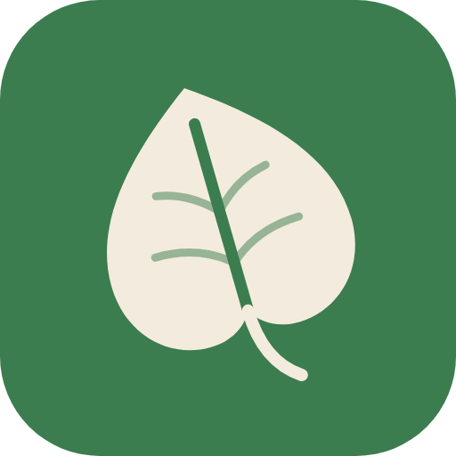

# PiantalAPP

Un database aperto di schede per la cura di piante e fiori, e un'app Android
che lo rende consultabile anche offline.

Ogni scheda spiega come annaffiare, concimare ed esporre una pianta, quanta luce
vuole, se sta in casa, fuori o in un terrarium. I contenuti sono scritti e
revisionati da una comunità di appassionati ed esperti.

## Struttura

```
dati/piante/        una scheda YAML per pianta (contenuti, CC BY-SA 4.0)
dati/funghi/        una scheda YAML per fungo, solo divulgativa
schema/             schemi JSON di piante e funghi
scripts/valida.py   validazione e generazione di dist/piante.json
.github/            validazione automatica delle pull request e modelli
app/                app Flutter (vedi app/README.md)
grafica/            logo e immagini per lo store
ARCHITETTURA.md     scelte tecniche e piano di lavoro
```

## Piante presenti

Nell'app le piante sono divise in quattro categorie, indicate nel campo
`gruppo` di ogni scheda: *Da appartamento*, *Piante grasse*, *Orchidee* e
*Da esterno*.

| Pianta | Nome scientifico | Dove |
|---|---|---|
| Ficus benjamina | *Ficus benjamina* | appartamento |
| Ficus robusta | *Ficus elastica* | appartamento |
| Ficus lyrata | *Ficus lyrata* | appartamento |
| Pothos | *Epipremnum aureum* | appartamento, ricadente |
| Sansevieria | *Dracaena trifasciata* | appartamento, succulenta |
| Fittonia | *Fittonia albivenis* | terrarium, appartamento |
| Spatifillo | *Spathiphyllum wallisii* | appartamento, fiorita |
| Liquidambar | *Liquidambar styraciflua* | esterno |
| Ficus Bambino | *Ficus lyrata* 'Bambino' | appartamento, da ufficio |
| Rosa ibrida di tea | *Rosa × hybrida* (Ibridi di Tea) | esterno, balcone, fiorita |
| Rosa floribunda | *Rosa × hybrida* (Floribunda) | esterno, balcone, fiorita |
| Rosa rampicante | *Rosa × hybrida* (rampicanti) | esterno, fiorita |
| Rosa inglese | *Rosa × hybrida* (arbustive e inglesi) | esterno, balcone, fiorita |
| Rosa miniatura | *Rosa × hybrida* (miniatura) | balcone, fiorita |
| Ortensia | *Hydrangea macrophylla* | esterno, balcone, fiorita |
| Phalaenopsis | *Phalaenopsis* | appartamento, fiorita |
| Dendrobium | *Dendrobium nobile* | appartamento, fiorita |
| Cymbidium | *Cymbidium* | appartamento, balcone, fiorita |
| Stella di Natale | *Euphorbia pulcherrima* | appartamento, fiorita |
| Kalanchoe | *Kalanchoe blossfeldiana* | appartamento, succulenta, fiorita |
| Aloe vera | *Aloe vera* | appartamento, balcone, succulenta |
| Albero di giada | *Crassula ovata* | appartamento, balcone, succulenta |
| Echeveria | *Echeveria elegans* | appartamento, balcone, succulenta |
| Haworthia | *Haworthiopsis attenuata* | appartamento, succulenta |
| Mammillaria | *Mammillaria zeilmanniana* | appartamento, balcone, succulenta, fiorita |
| Fico d'India nano | *Opuntia microdasys* | appartamento, balcone, succulenta |
| Oleandro | *Nerium oleander* | esterno, balcone, fiorita, siepe |
| Alloro | *Laurus nobilis* | esterno, balcone, siepe |
| Lauroceraso | *Prunus laurocerasus* | esterno, siepe |
| Fotinia | *Photinia × fraseri* | esterno, siepe |
| Bosso | *Buxus sempervirens* | esterno, balcone, siepe |
| Ligustro | *Ligustrum ovalifolium* | esterno, fiorita, siepe |
| Pitosforo | *Pittosporum tobira* | esterno, balcone, fiorita, siepe |

## Funghi

La sezione *Funghi* mostra ogni specie con il nome comune e, tra parentesi, il
nome latino: ad esempio *Porcino (Boletus edulis)*. Ogni scheda ha una foto
da Wikimedia Commons e descrive habitat, stagione, aspetto, commestibilità e
soprattutto i **sosia** con cui si può confondere.

> **Le schede non servono a riconoscere i funghi da mangiare.** L'app lo
> ricorda in cima all'elenco e in ogni scheda: prima di consumare funghi
> raccolti bisogna farli controllare, gratis, dall'Ispettorato micologico
> della ASL.

| Fungo | Commestibilità |
|---|---|
| Chiodino (*Armillaria mellea*) | commestibile con cautela |
| Colombina (*Russula virescens*) | commestibile |
| Dentino (*Hydnum repandum*) | commestibile |
| Galletto (*Cantharellus cibarius*) | commestibile |
| Mazza di tamburo (*Macrolepiota procera*) | commestibile |
| Ovolo (*Amanita caesarea*) | commestibile |
| Pioppino (*Cyclocybe aegerita*) | commestibile |
| Porcino (*Boletus edulis*) | commestibile |
| Prataiolo (*Agaricus campestris*) | commestibile |
| Tartufo bianco (*Tuber magnatum*) | commestibile |
| Tartufo nero (*Tuber melanosporum*) | commestibile |
| Tignosa verdognola (*Amanita phalloides*) | mortale |
| Trombetta dei morti (*Craterellus cornucopioides*) | commestibile |

## Google Play Store

I passi per la pubblicazione, le risposte ai moduli della Play Console e la
gestione della chiave di caricamento sono in [docs/PLAY-STORE.md](docs/PLAY-STORE.md).
Testi, icona, grafica e screenshot della scheda sono in
`fastlane/metadata/android/it-IT`.

## iPhone e iPad

- **Subito, senza App Store:** apri https://pxcalleg.github.io/piantalapp/ con
  Safari, tocca *Condividi* e poi *Aggiungi alla schermata Home*. PiantalAPP
  compare tra le app con la sua icona e si apre a schermo intero.
- **App vera e propria:** il progetto iOS è in `app/ios` e GitHub lo compila a
  ogni modifica (controllo *App iOS*). Per installarla sugli iPhone serve:
  1. un account [Apple Developer](https://developer.apple.com/programs/)
     (99 € l'anno, a nome di una persona o di un'azienda);
  2. registrare l'identificativo `io.github.pxcalleg.piantalapp` e creare
     l'app su [App Store Connect](https://appstoreconnect.apple.com);
  3. firmare e caricare la build: da un Mac con Xcode, oppure aggiungendo a
     GitHub le chiavi di App Store Connect perché la carichi da solo su
     TestFlight;
  4. provarla con TestFlight e inviarla alla revisione di Apple.

## Riconoscere una pianta da una foto

Il pulsante *Riconosci* invia la foto a [Pl@ntNet](https://plantnet.org),
che la analizza senza conservarla e propone le specie più probabili, con il
link alla scheda quando la pianta è già in archivio. Il piano gratuito
consente 500 riconoscimenti al giorno.

La chiave del servizio non è nel codice: GitHub la inserisce al momento della
compilazione dal secret `PLANTNET_API_KEY`. Nelle impostazioni della chiave su
[my.plantnet.org](https://my.plantnet.org) va spuntato *expose my API key*,
con `https://pxcalleg.github.io` tra i domini autorizzati. Per provarla in
locale: `flutter run --dart-define=PLANTNET_API_KEY=la-tua-chiave`.

## Contribuire

Vedi [CONTRIBUTING.md](CONTRIBUTING.md). Non serve saper programmare.

## Licenze

- Codice: [Apache 2.0](LICENSE)
- Contenuti in `dati/`: [CC BY-SA 4.0](dati/LICENSE.md)
- Foto: da Wikimedia Commons, ognuna con la sua licenza libera; autore e licenza
  sono in `app/assets/immagini/crediti.json` e sotto ogni foto nell'app
